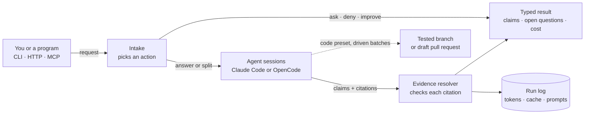

<!-- readme:header:start -->
<picture><source media="(prefers-color-scheme: dark)" srcset="https://raw.githubusercontent.com/Egoushka/Egoushka/main/assets/card-chargehand-dark.svg"></picture>

<p>
  
  <a href="https://github.com/Egoushka/chargehand/actions/workflows/ci.yml"></a>
  
</p>
<!-- readme:header:end -->

# chargehand

> An orchestrator for coding agents (Claude Code, OpenCode): send a question or a change, get back typed JSON where every claim cites a file at a pinned commit.

<!-- readme:status:start -->
**Active**. I work on it this month.
<!-- readme:status:end -->



## Why

Coding agents answer in prose. A program that calls one needs something it can check: claims tied to files at a
commit, diffs, session messages or the caller's own inputs, plus a confidence and the exact prompts behind the answer.
I also wanted the control flow (the task graph, budgets, retries, parallelism) in code rather than in a prompt, so each
agent's context stays small, cached and disposable.

## What it does

- **Answers with checked citations.** A *citation* is a file and line range, a commit, a diff range, a session
  message or an input id. Each one must exist at the pinned commit before a claim leaves its worker; the worker gets
  one repair turn, and claims that still fail move to open questions.
- **Splits a question** into 2 to 4 read-only subtasks run as a task graph, when intake chooses it and the preset
  allows it. Later subtasks reuse the first one's cached prompt prefix.
- **Presets** set the tools, the token and dollar budgets and the allowed actions: `default`, `cheap`, `thorough`,
  `strict`, `draft` (for programs that bring their own facts), `review`, and `code`, which writes a branch that passes
  its tests in a sandbox.
- **Driven batches** run a list of tasks as parallel Claude Code sessions, one locked-down container each, and end
  each in a draft pull request.
- **Plugs into your tools.** An MCP server (stdio or HTTP), an HTTP API, a CLI, a Claude Code plugin
  (`/chargehand:change`: one prompt to a reviewed change on a local branch) and an operator console in the browser.
- **Measures itself.** The run log records tokens, cache hits, cost and the prompt chain of every call; *Prompt CI*
  gates prompt and preset changes on paired evals before they merge.

Not here: an agent loop of its own, direct calls to model providers, a model gateway, a memory store (it uses yours
over MCP), a hosted service. A citation that resolves points at something that exists; checking that the cited text
supports the claim is planned, not built ([roadmap](ROADMAP.md)).

> [!WARNING]
> Before 1.0. The images have no `latest` tag: pin an exact version and read the [changelog](CHANGELOG.md) before you upgrade.

## Quick start

From a clone, ask one question about chargehand itself. Needs the .NET 10 SDK, git, and Claude Code 2.1.283 on
`PATH`, signed in (run `claude` once). With no profile, the workers use the CLI's own login and default model.

```bash
git clone https://github.com/Egoushka/chargehand.git && cd chargehand
cat > request.json <<EOF
{
  "contract_version": "request/v1",
  "text": "Where does a split node decide whether to fork the first node's session? Cite the code.",
  "context": { "interactive": false, "preset": "default",
               "repository": { "path": "$PWD", "commit": "$(git rev-parse HEAD)" } }
}
EOF
dotnet run --project src/Chargehand.Cli -- run < request.json
```

It prints `result/v1` on stdout: claims with citations, open questions, a confidence and the cost. The
[quickstart guide](docs/guide/quickstart.md) explains every field, OpenCode instead of Claude Code, and what to do
when a run fails.

To use it from an MCP client without a clone, run the package from nuget.org with `dnx`, pinned to a release:

```bash
claude mcp add chargehand -e CLAUDE_CODE_OAUTH_TOKEN=<token> -- dnx Chargehand@<version> --yes -- mcp
```

## How it works

1. **Intake** reads the request (`request/v1`) and writes a *Task Spec*: one action, `answer`, `split`, `ask`, `deny`
   or `improve`. The last three stop the run with questions, a reason or a better request. A preset can also stop a
   run for approval above a risk or cost estimate.
2. **Workers** are ordinary Claude Code or OpenCode sessions on a clone of the repository at the pinned commit,
   inside the directories the profile allows. chargehand never calls a model provider itself.
3. **The evidence resolver** checks every citation against git, the session and the request. The invariant: no claim
   reaches the result unless its citations resolved.
4. **The result** (`result/v1`) carries the claims, the open questions, usage and the prompt chain. The same record
   goes to the run log, which `show`, `cache` and `routes` read.

Writing runs follow the same path with a sandboxed worker: the `code` preset verifies a branch with the repository's
tests, and driven batches add an egress allowlist, a runner that alone holds the Docker socket, and a check gate
before a pull request opens. [ARCHITECTURE.md](ARCHITECTURE.md) maps the code.

## Numbers

| | Value | Source |
|---|---|---|
| Citations that resolved, read-only runs | 50 of 50 (phase 3), 99 of 99 (phase 4) | [benchmarks](docs/benchmarks.md) |
| Cost of a split against one plain session | 1.53× ($0.00754 vs $0.00492 a run) for a blind score of 0.967 vs 0.950 | [phase 4](docs/benchmarks.md) |
| Deliberate prompt regressions Prompt CI blocked | 1 of 2, and only after the score added completeness | [Prompt CI](docs/benchmarks.md) |
| Quality benchmark on public repositories | 13 tasks over 4 pinned repositories; no real run yet | [benchmark](docs/guide/benchmark.md) |
| Users | 1, me | counted |

## Lessons

- **Parallelism did not pay on the questions I measured.** Splits resolved every citation but cost half again as
  much for a small score gain, so the shipped `default`, `review` and `draft` presets allow no split
  ([ADR 0017](docs/adr/0017-split-runs-forked-siblings-and-merge.md)).
- **A score that measures what run-time checks already enforce catches nothing.** The first Prompt CI score measured
  grounding, which the resolver already forces, so a prompt that dropped a third of the claims passed. The score now
  multiplies grounding by completeness ([ADR 0019](docs/adr/0019-prompt-ci-and-routing-report.md)).

## Docs

- [Overview](docs/guide/index.md): what it is, how a run works, what it leaves out, status
- [What it does, and how we know](docs/guide/capabilities.md): each capability with its status and evidence
- [Quickstart](docs/guide/quickstart.md) · [Install with Docker Compose](docs/guide/install.md): from a clone, or from the release images
- [Use it from an MCP client](docs/guide/mcp.md) · [Run the HTTP server](docs/guide/server.md) · [Web UI](docs/guide/web-ui.md)
- [Writing a branch](docs/guide/writing.md) · [Driven writing sessions](docs/guide/driven.md) · [Several runners](docs/guide/runners.md)
- [The change command](docs/guide/change.md): the Claude Code plugin
- [Memory and services](docs/guide/memory-and-services.md) · [Prompt CI](docs/guide/prompt-ci.md) · [Benchmark](docs/guide/benchmark.md)
- [Reference](docs/guide/reference.md): commands, routes, presets, contracts, profile fields, environment variables
- [Architecture](ARCHITECTURE.md) · [Decisions](docs/guide/decisions.md) · [Changelog](CHANGELOG.md) · [Roadmap](ROADMAP.md)
- [Contributing](CONTRIBUTING.md) · [Security](SECURITY.md) · [Apache-2.0 license](LICENSE)
